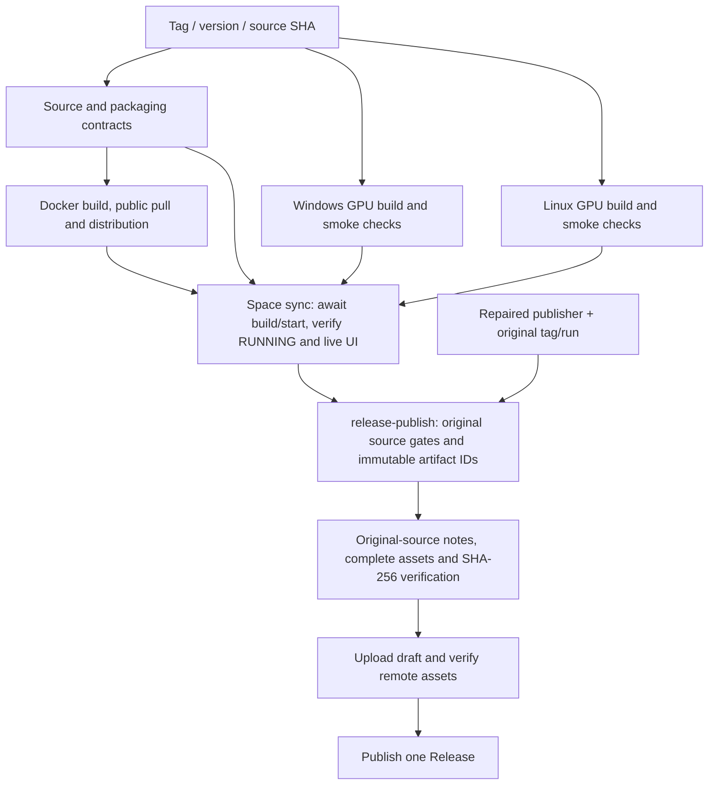

# Windows 便携版打包

目录式 `exe` 便携版随包提供 Python 环境，解压后即可启动。

Windows 分卷必须全部下载到同一个目录，并保留原始文件名。从 `.wim.001` 解压一次即可，解压工具会自动读取后续分卷；“只点第一卷解压”是正常步骤，不代表只使用了第一卷。不要逐卷分别解压，也不要只下载第一卷。7-Zip 26.02 是已验证工具；360 压缩等软件需要支持该分卷格式，并且解压过程不能出现缺卷、CRC 或数据错误。其不同版本是否恢复 WIM 硬链接尚未逐一验收，不能仅凭能启动就断言整包资源完整。

All Windows volumes belong in the same folder with their original filenames. Extract from `.wim.001` once; the extractor reads subsequent volumes automatically. Do not extract each volume separately or download only the first one. 7-Zip 26.02 is the verified extractor. Compatible tools such as 360 Compression must complete without missing-volume, CRC or data errors; their WIM hard-link restoration has not been verified across versions.

当前源码的伴奏模型为 Leap Instrumental。[第三方清单](../THIRD_PARTY_NOTICES.md) 已记录该固定权重及原始配置的独立 `OWNER_ACCEPTED` 分发决定；完整包仍须通过组件清单、资源身份与成品自检，产物验收状态以对应版本 Actions 结果为准。

## 一键打包

在已安装好开发环境、且模型已下载完成的构建机上执行。该命令一次生成桌面 App、Web 后端、Web 前端三个独立目录：

```powershell
powershell -ExecutionPolicy Bypass -File .\build_web_executables.ps1
```

Intel XPU 使用独立环境与入口：

```powershell
powershell -ExecutionPolicy Bypass -File .\build_portable_xpu.ps1
```

自定义 Python 或 `ffmpeg` 路径：

```powershell
powershell -ExecutionPolicy Bypass -File .\build_web_executables.ps1 `
  -PythonExe .\venv\Scripts\python.exe `
  -FfmpegDir C:\ffmpeg\bin
```

完整 XPU 包超过 20 GB。需要把构建临时目录和成品放到其他 NTFS 目录时：

```powershell
powershell -ExecutionPolicy Bypass -File .\build_portable_xpu.ps1 `
  -BuildRoot C:\MusicToMidi-XPU-build `
  -DistRoot C:\MusicToMidi-XPU-dist
```

XPU 构建默认对同卷的暂存资源使用 NTFS 硬链接，跨卷资源逐文件复制；暂存资源与成品资源都会进行身份校验。硬链接失败会停止构建，不会自动改为复制。

## 便携包内容

- Python 解释器与依赖库
- YourMT3+、MIROS、MuScriptor 的固定源码与权重，包括五种 YourMT3+ checkpoint 和 MuScriptor Small / Medium / Large
- Leap XE、Leap Instrumental 与 BS-RoFormer SW Fixed 分离模型
- TransKun V2 / V2 Aug、Aria-AMT 与 ByteDance Pedal 钢琴模型
- Beat This `final0` 节拍模型
- MuseScore General SoundFont、FluidSynth 与 MuseScore Studio 乐谱运行环境
- `ffmpeg.exe` 与 `ffprobe.exe`

完整 App 和 Web 后端包需要以上全部资源；缺少资源或身份校验失败时，构建会停止。Web 前端目录只提供浏览器界面，通过网络连接推理后端。

## 目标机器依赖

- CUDA 包需要兼容的 NVIDIA 显卡与驱动；驱动需在目标机器上单独安装
- Intel GPU 使用 XPU 包，并安装兼容的 Intel 显卡驱动；新增 Leap Instrumental 伴奏路线尚未完成 XPU 实机验收
- 不提供 Vulkan 运行环境

## 非 NVIDIA 显卡说明

- Windows Intel 使用独立的 PyTorch XPU + OpenVINO GPU 便携包；启动时检查 XPU FFT/STFT/BF16 与 OpenVINO `GPU.0` 运算。
- XPU 环境不兼容 IPEX、DirectML 或 CUDA ORT 混装；启动检查失败时停止。
- AMD/ROCm 当前缺少完整七模式所需的 GPU 运行环境，因此不在便携版支持范围内；启动检查失败时会停止。

## 发布目录

`release.yml` 是完整版本的编排入口。推送与工程版本一致的 `vX.Y.Z` 标签，或在同一标签提交手动运行，即可执行下列流程；全部验收通过后自动调用 `release-publish.yml` 公开版本。安装包、容器包使用同一源码 SHA；公开前校验每个平台的连续分卷和所有附件的 SHA-256。任一检查或上传失败都不会将草稿公开，也不会覆盖既有公开版本。

`release.yml` coordinates a complete version. Push a matching `vX.Y.Z` tag or run it manually at that exact tagged commit; after acceptance, it automatically calls `release-publish.yml` to publish. Portable and Docker packages share one source SHA; publication requires consecutive volumes and verified local/remote SHA-256 for every asset. Failed checks/uploads leave the draft unpublished and never overwrite an existing public version.

如果只有发布工具需要修复，可在修复后的分支运行 `release-publish.yml`，传入原标签 `tag` 和原 `release.yml` 运行 ID `artifact_run_id`。`tools/release_provenance.py` 要求原运行属于同一仓库、同一正式工作流、同一标签提交，所有源码、双平台安装包、容器及 Space 检查成功；外部未完成、取消或缺失验收的运行不能发布。只下载该运行三个未过期的不可变产物 ID，并由下载动作核验摘要，再逐文件核验原构建清单。发布工具可以来自修复提交，但安装包、镜像和发行说明仍来自已验收的原标签，不移动标签或重新构建。正常编排也执行同一套来源检查。

When only the publisher needs repair, run `release-publish.yml` from the repaired branch with the original `tag` and `artifact_run_id` from `release.yml`. `tools/release_provenance.py` requires the same repository, release workflow and tagged source commit, with all source, native Windows/Linux, container and Space gates successful. Other unfinished, cancelled or incompletely verified runs cannot publish. Downloads select exactly three nonexpired immutable artifact IDs and require digest validation, followed by per-file build-manifest checks. Publisher code may come from a repair commit; binaries, images and release notes retain the original verified tagged source without moving the tag or rebuilding. Normal orchestration performs the same provenance checks.

草稿查询使用认证后的分页 Release 列表精确匹配标签。[GitHub 的按标签接口](https://docs.github.com/en/rest/releases/releases#get-a-release-by-tag-name)只返回已公开版本，不能用于判断草稿是否存在。现有草稿附件必须与预期集合、大小、状态及摘要相符；所有附件确认完整后才公开。

Draft discovery matches the exact tag in authenticated, paginated release listings. GitHub's by-tag endpoint only returns published releases, so it cannot establish draft existence. Existing draft assets must match expected names, sizes, states and digests; publication occurs only after the complete remote asset set is verified.

Space 同步还必须确认 Hub 中的精确提交、运行状态 `RUNNING`、声明的 Gradio 版本及真实界面的组件和事件图。只等待官方定义的 `BUILDING`、`RUNNING_BUILDING`、`APP_STARTING`、`RUNNING_APP_STARTING` 四种中间状态；旧实例仍可访问时，也必须等待替换实例启动完成。构建错误、运行错误、未知状态、HTTP 错误或启动超时都会阻断发布；等待正在进行的构建不会重启服务或重装依赖。状态定义与 [HF 官方实现](https://github.com/huggingface/huggingface_hub/blob/main/src/huggingface_hub/_space_api.py) 和 [等待接口文档](https://huggingface.co/docs/huggingface_hub/v1.32.0/en/package_reference/hf_api#huggingface_hub.HfApi.wait_for_space) 对齐。

Space synchronization also verifies the exact Hub commit, `RUNNING` status, declared Gradio version and the live UI's component/event graph. Only the four official intermediate states (`BUILDING`, `RUNNING_BUILDING`, `APP_STARTING`, `RUNNING_APP_STARTING`) are awaited; an older live instance cannot satisfy replacement-app readiness. Build/runtime/HTTP errors, unknown states or a startup timeout block publication. Waiting for an in-flight build never restarts the service or reinstalls dependencies. State definitions match the official HF implementation and wait API linked above.



发行附件仅包含完整包、轻量前端、Docker ZIP/tar.gz 和 `SHA256SUMS.txt`。内部构建清单用于 Actions 任务间校验，不上传 Release；测试报告、截图和日志也不作为发行附件。包内许可证、第三方声明、依赖清单和 FFmpeg 构建记录保留。

Public assets contain complete bundles, lightweight frontends, Docker ZIP/tar.gz and `SHA256SUMS.txt`. Internal build manifests are used between Actions jobs but excluded from Release assets, as are test reports, screenshots and logs. Packages retain licenses, third-party notices, dependency inventories and FFmpeg build records.

- 桌面 App 的完整目录为 `dist\MusicToMidi-App\`
- Web 版的两个完整目录为 `dist\MusicToMidi-WebBackend\` 与 `dist\MusicToMidi-WebFrontend\`
- XPU 对应目录为 `dist\MusicToMidi-XPU-App\` 与 `dist\MusicToMidi-XPU-WebBackend\`
- 每个程序都需要 EXE 和同目录 `_internal`；复制整个目录即可保留完整运行文件
- 首次运行时程序会优先读取 exe 邻近的 `models/` 和 `tools/ffmpeg/`
- 日志和运行时缓存优先写入 EXE 邻近的 `runtime/`；该目录不可写时改用用户目录


## ChordMini BTC / 和弦识别资源

桌面结果窗口使用 ChordMini BTC，固定官方提交 `aa6e3a8d7b017f082fd2aaff9329d5c26af49c03`。完整模型准备脚本包含此资源；单独准备使用 `python download_chordmini_model.py`。构建前、暂存后与最终 App 目录均校验 `resources/chordmini-source.json` 中的源码、配置、README、LICENSE 和 BTC 权重身份，打包到 `models/chordmini`。`--chordmini-worker` 是可执行文件内部后台入口，隔离官方 `src` 命名空间，使用指定 NVIDIA GPU，与转写任务共享资源锁；模型失败不替换引擎。现有第三方发布门禁仍然有效，本次不发布安装包。

The desktop result window uses ChordMini BTC at the pinned official revision above. Both `download_sota_models.py` and the standalone downloader prepare it. Source, staging and packaged App resources are verified against the per-file manifest and included under `models/chordmini`, with the upstream README and license. The internal `--chordmini-worker` entry isolates the upstream namespace and uses the selected NVIDIA device under the shared inference lock. Failed inference never substitutes another chord engine. All existing release gates remain in effect; this change does not publish a new package.

## Linux 便携版（NVIDIA P40 / sm_61）

`build_portable_linux.sh` 在 Ubuntu / Linux Mint x86_64 构建机上生成 PyInstaller `onedir` 目录，与 Windows 便携版共用同一份 `MusicToMidi.spec`，输出 `MusicToMidi`（GUI）、`MusicToMidiCLI`、`MusicToMidiBackend` 三个入口，以及 `gui.sh`、`cli.sh`、`backend.sh`、`p40-check.sh` 启动脚本。

目标显卡为 NVIDIA Tesla P40（Pascal / Compute Capability 6.1 / `sm_61`），同时兼容更新的 NVIDIA 显卡。构建使用 PyTorch 2.7.0 `+cu126`：该 wheel 的 SASS 列表包含 `sm_60`，按 NVIDIA 二进制兼容规则可在 `sm_61` 上直接执行；`cu128` 构建不包含任何 `sm_61` 可执行代码，不能用于 P40。

### 环境要求

构建机：

- Linux x86_64，Python 3.12（`/usr/bin/python3.12`）
- 源码位置可写，剩余磁盘空间 ≥ 60 GB（成品约 24 GB，另需构建中间目录与压缩包空间）
- 已解包的 v1.10.0 便携版资源目录（含 `models/`、`resources/`、`tools/`、`external/`）

运行机：

- Linux x86_64，glibc ≥ 2.39（产物在本机构建，不提供更老 glibc 的兼容层）
- 兼容 CUDA 12.6 的 NVIDIA 驱动（≥ 525.60.13，建议 550 及以上）
- GUI 需要 X11 或 Wayland；无显示环境请使用 `cli.sh`

### 构建环境

```bash
/usr/bin/python3.12 -m venv venv
venv/bin/pip install --upgrade pip setuptools wheel

# P40 兼容的 CUDA 12.6 三件套
venv/bin/pip install torch==2.7.0 torchaudio==2.7.0 torchvision==0.22.0 \
  --index-url https://download.pytorch.org/whl/cu126

# 其余依赖（aria-amt / ariautils / muscriptor 使用固定源码或本地副本）
venv/bin/pip install -r requirements.txt
venv/bin/pip install audio-separator==0.44.1 --no-deps
venv/bin/pip install "transkun==2.0.1" --no-deps --force-reinstall
venv/bin/pip install pyinstaller
```

`audio-separator` 的运行时依赖（`onnx-weekly`、`onnx2torch-py313`、`diffq-fixed`、`onnxruntime-gpu==1.23.2` 等）、`aria-amt`/`ariautils` 与 `muscriptor==0.4.0` 需要与 `install.sh` 相同的固定版本；在无法访问 GitHub 的环境中，可从已发布的 v1.10.0 App 的 `_internal` 复制对应包，并保持 `src/utils/muscriptor_source_identity.py` 中的文件哈希一致。

### 本地模型来源

默认自动探测以下位置，也可以显式指定：

```bash
./build_portable_linux.sh --model-source "/path/to/MusicToMidi-Windows-GPU-App/_internal"
```

脚本识别的资源根目录包含 `models/`（或 `_internal/models/`），并把下列目录映射为 `MusicToMidi.spec` 需要的 `MUSIC_TO_MIDI_BUNDLE_*` 环境变量：

```
models/{aria_amt,audio-separator,beat_this,bytedance_piano,chordmini,
        muscriptor_small,muscriptor_medium,muscriptor_large,muscriptor_assets,
        transkun_v2_aug,yourmt3_all}
external/ai4m-miros
resources/{fluidsynth,musescore}
tools/ffmpeg
```

模型只在构建时从本地复制，运行时不下载。ChordMini 资源按 `resources/chordmini-source.json` 逐文件校验 SHA-256，校验失败会停止构建。

### 构建与打包

```bash
# 构建到 dist-linux/MusicToMidi-Linux-P40
./build_portable_linux.sh

# 构建后同时生成 tar.xz 与 SHA256
./build_portable_linux.sh --package
```

常用选项：`--venv`、`--dist`、`--work`、`--name`、`--no-clean`、`--allow-arch-mismatch`。`--package` 使用 `xz -T0 -1` 生成 `<name>-linux-x86_64.tar.xz` 与 `.sha256`。

### 脚本自动修复项

PyInstaller 收集完成后，脚本会执行三项必要的产物修复：

1. **libbrotli 版本统一**：PyInstaller 会把 Pillow 自带的新版 `libbrotli*` 与 MuseScore/系统旧版收集成同名库，导致导入 `onnxruntime` 时报 `undefined symbol: BrotliSharedDictionaryDestroyInstance`。脚本用 `pillow.libs` 中的一对库覆盖 `_internal/libbrotlicommon.so.1` 与 `libbrotlidec.so.1`。
2. **FFmpeg 运行库补齐**：内置 FFmpeg 4.4 为动态链接，spec 只复制 `tools/ffmpeg`，不会带上 `libav*`/`libsw*`。脚本从模型源目录递归补齐缺失的 soname。
3. **FluidSynth glibc 清理**：FluidSynth 的 `lib/` 内含构建机 glibc（`libc.so.6`、`libm`、`libpthread` 等），在较新系统上会段错误。脚本删除这些核心库，让 FluidSynth 使用宿主 glibc。

脚本还会清理 `LD_LIBRARY_PATH` 中的空条目（等价于当前目录），避免打包过程中误加载 MuseScore 自带的旧版库。

### 验收

```bash
cd dist-linux/MusicToMidi-Linux-P40

# GUI/Qt/ONNX Runtime 加载顺序
MUSIC_TO_MIDI_ACCELERATOR=cuda ./MusicToMidi --self-test-gui-package
MUSIC_TO_MIDI_ACCELERATOR=cuda ./MusicToMidi --self-test-gui-runtime

# 13 条转换路线
./MusicToMidiCLI routes --json

# 单文件转换（示例）
MUSIC_TO_MIDI_ACCELERATOR=cuda ./MusicToMidiCLI convert song.wav -o out --mode piano_transkun
```

已在本机（RTX 4060，`sm_89`）验证：7 种处理模式、YourMT3+ / MIROS / MuScriptor 后端、无头 GUI 转换探针、FluidSynth 渲染与 MuseScore `AppRun --version`。尚未在真实 P40 上运行；`sm_60` SASS 的二进制兼容性依据 NVIDIA 文档与 PyTorch 架构列表判定。

### P40 与 BF16

Tesla P40 不支持 CUDA BF16 运算。`Config.cuda_bf16_policy`（默认 `auto`）会通过 `src/utils/gpu_utils.py` 检测设备能力：P40 上 Aria-AMT 等 BF16 路径自动回退 FP32，支持 BF16 的新显卡继续使用 BF16。需要强制时可用 `--cuda-bf16-policy fp32|bf16`。

### 六声部分离的离线注册表

`audio-separator 0.44.1` 的 `list_supported_model_files()` 在读取注册表前会联网拉取 UVR 的 `download_checks.json`。便携包没有网络，因此 `src/core/multi_stem_separator.py` 在缺少本地清单时，用一次性临时目录承载空骨架完成注册，再把本地 `BS-Rofo-SW-Fixed.ckpt` / `.yaml` 注册为 MDXC 模型；随包的 `models.json` 仍会正常合并。模型权重与配置已随包分发，分离阶段不会下载文件。

如果用户目录中已存在 `download_checks.json`，则直接使用上游完整注册表，不做替换。

### 已知限制

- 产物按构建机 glibc 2.39 构建，只能在不低于该版本的系统运行；如需兼容 Ubuntu 20.04/22.04，应在更老的基础镜像中重新构建。
- 未提供 CPU 版；缺少兼容 NVIDIA GPU 或驱动时会显式报错，而不是静默回退。
- 本仓库的 `build_portable.ps1` / `build_web_executables.ps1` 仅适用于 Windows；Linux 只使用 `build_portable_linux.sh`。

The Linux portable build (`build_portable_linux.sh`) shares `MusicToMidi.spec` with the Windows build and produces the `MusicToMidi`, `MusicToMidiCLI` and `MusicToMidiBackend` entry points plus launcher scripts. It targets Tesla P40 (`sm_61`) with a PyTorch 2.7.0 `+cu126` runtime (its `sm_60` SASS is binary-compatible with `sm_61`) and remains compatible with newer NVIDIA GPUs. Models are copied from a local unpacked v1.10.0 asset directory; nothing is downloaded at build or run time. The script normalizes conflicting libbrotli libraries, fills missing FFmpeg `libav*`/`libsw*` dependencies, and removes the bundled FluidSynth glibc so it uses the host libc. Six-stem separation works offline: when no local `download_checks.json` exists, the separator seeds a temporary empty registry skeleton and registers the bundled BS-RoFormer SW checkpoint locally. The bundle requires glibc ≥ 2.39 at runtime; no CPU fallback is provided.
